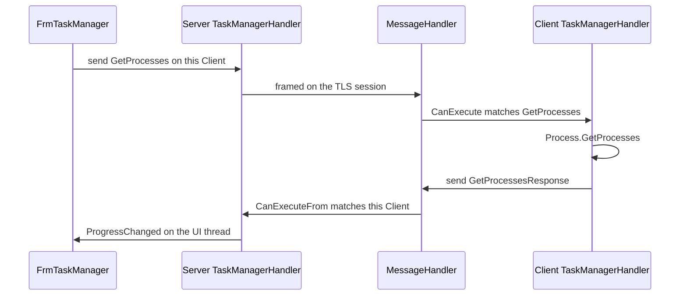

# Message bus

Every feature uses the same dispatcher. The dispatcher does not know about files, processes, or desktops. It only knows which registered objects claim a message.

The implementation is `Quasar.Common/Messages/MessageHandler.cs`. It is a static class. Both processes have their own copy, because each executable has its own static state.

## The three types

`IMessage` is an empty interface. A protocol class is a bag of protobuf fields that implements it. Naming is consistent:

| Prefix | Direction | Example |
|---|---|---|
| `Get` | Console asks the agent for data | `GetProcesses` |
| `Do` | Console tells the agent to perform an action | `DoProcessEnd` |
| `*Response` | Agent reports the result | `GetProcessesResponse`, `DoProcessResponse` |

`IMessageProcessor` is a handler:

- `CanExecute(IMessage)` — is this my message type?
- `CanExecuteFrom(ISender)` — is this my connection?
- `Execute(ISender, IMessage)` — do the work.

`MessageProcessorBase<T>` is an abstract processor that also implements `IProgress<T>`. Server handlers extend it. Client handlers usually implement `IMessageProcessor` directly, because they do not need to marshal onto a UI synchronization context.

## Process

`MessageHandler.Process(sender, message)`:

1. Takes the lock.
2. Filters `Processors` to those where `CanExecute` and `CanExecuteFrom` are both true.
3. Copies that filter to a list so the lock can be released before any handler runs.
4. Calls `Execute` on each match.

`Register` ignores a second registration of the same instance. `Unregister` removes it. Both take the same lock.

More than one processor may run for one message. In practice each message type belongs to one handler. The filter is what keeps two open windows on the server from handling each other's replies.

## Who is registered, and when

**Client.** `QuasarApplication.InitializeMessageProcessors` runs once, on the UI thread, before the connect loop. It registers every feature handler for the life of the process. `CanExecuteFrom` on these handlers returns true for any sender, because the agent has one server connection.

The client processors are:

- `ClientServicesHandler`
- `FileManagerHandler`
- `KeyloggerHandler`
- `MessageBoxHandler`
- `PasswordRecoveryHandler`
- `RegistryHandler`
- `RemoteDesktopHandler`
- `RemoteShellHandler`
- `ReverseProxyHandler`
- `ShutdownHandler`
- `StartupManagerHandler`
- `SystemInformationHandler`
- `TaskManagerHandler`
- `TcpConnectionsHandler`
- `WebsiteVisitorHandler`

Some of those also implement `NotificationMessageProcessor`. Their progress events are wired to the tray balloon, unless unattended mode is on.

**Server.** `FrmMain` registers only the status handler. A feature form constructs its handler in the constructor, subscribes to that handler's events, and calls `MessageHandler.Register`. `Dispose` or form close unregisters it. `CanExecuteFrom` returns true only when `sender` is the `Client` the handler was constructed with.

That is why the server can show Task Manager for two machines at once. Each form has its own handler instance, and each instance ignores messages from the other connection.

## UI thread

Socket reads do not happen on the UI thread. Server handlers report results through `MessageProcessorBase<T>.OnReport`. If a `ProgressChanged` subscriber exists, the base class posts the value to the `SynchronizationContext` captured at construction. Feature forms construct the handler on the UI thread and pass `useCurrentContext: true`, so the list view is updated on the UI thread.

`MessageProcessorBase` also exposes a second pattern used by task manager: the handler posts a custom event (`ProcessActionPerformed`) through the same synchronization context.

Client handlers send a response from `Execute`. They do not paint UI.

## One feature, end to end

Task Manager is the template. The same shape is used by the other request/response features.

Code path:

1. `FrmTaskManager.CreateNewOrGetExisting` keeps a static dictionary of open forms keyed by `Client`. Opening the feature twice focuses the existing window.
2. The constructor stores the `Client`, creates `TaskManagerHandler` with that client, and registers it.
3. The form sends `GetProcesses`.
4. `Quasar.Client/Messages/TaskManagerHandler.CanExecute` matches `GetProcesses`, `DoProcessStart`, and `DoProcessEnd`. `Execute` switches on the runtime type.
5. The get-processes branch builds a `Quasar.Common.Models.Process` array and sends `GetProcessesResponse`.
6. `Quasar.Server/Messages/TaskManagerHandler.CanExecute` matches `GetProcessesResponse` and `DoProcessResponse`. `CanExecuteFrom` requires the same `Client`.
7. The response branch reports the process array. The form's `TasksChanged` handler fills the list view.

Closing the form unregisters the handler and removes the dictionary entry. A disconnect event on that client closes or disables the form so it does not send into a dead socket.

## Where a message class lives

Request, response, and the model they carry are all in `Quasar.Common`. The client handler and the server handler live in their own projects and only share those types. If a field is added to a message, both handlers and the form that displays it have to be updated together. The socket and the dispatcher do not change.
