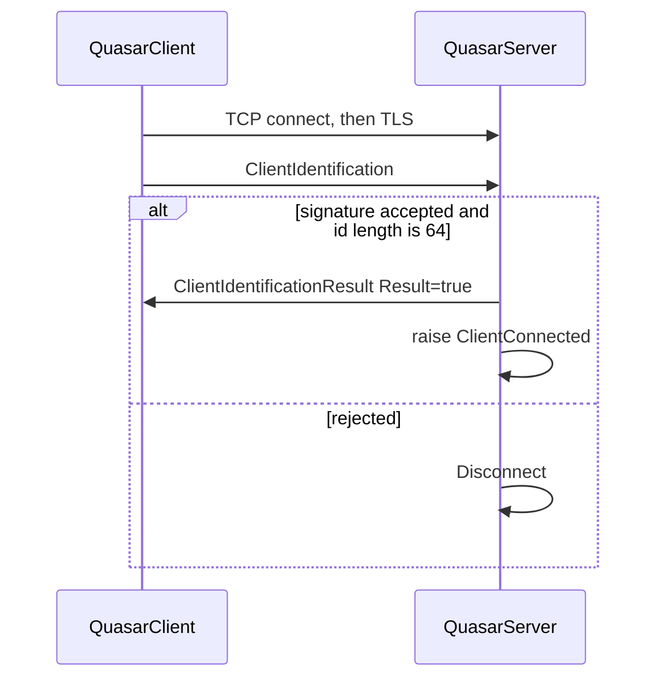

# Networking

There are two layers. `Server` and `Client` move bytes. `QuasarServer` and `QuasarClient` decide what those bytes mean.

```text
Quasar.Server/Networking/QuasarServer   identification, then MessageHandler
        └── Server                        listen, accept, TLS, client list
                └── Client                one socket, one SslStream

Quasar.Client/Networking/QuasarClient    reconnect loop, identification
        └── Client                        connect, TLS, frame, send, receive
```

Both `Client` classes implement the shared `ISender` interface. Handlers call `Send` and do not touch the socket.

## Listen and connect

The server binds a `Socket` and accepts connections. Each accepted socket is tracked in a locked client list. `QuasarServer.ConnectedClients` is that list filtered to clients that have passed identification. The main window uses this filtered list.

The client resolves the next entry from `HostsManager` and connects. `HostsConverter` parses the raw host string into `host:port` entries, separated so more than one server can be listed. `GetNextHost` walks that list across reconnects.

Optional UPnP lives in `Quasar.Server/Networking/UPnPService.cs`. The listen call passes `Settings.UseUPnP`. If it is on, the server asks the gateway to forward the listen port.

IPv6 is a flag on `Listen`, from server settings.

## TLS

Each connection is an `SslStream` over the network stream.

- The client calls `AuthenticateAsClient` with TLS 1.2.
- The client pins the server certificate from settings and checks it in `ValidateServerCertificate`.
- `Program.Main` on both sides sets `ServicePointManager.SecurityProtocol` to TLS 1.2 before any connection.

The certificate is created and stored by the server (`FrmCertificate`, `Helper/CertificateHelper.cs`). The client build carries the public certificate it is willing to accept. A connection that fails the pin does not proceed to identification.

## Framing

Application data is not HTTP. One message is a 4-byte little-endian length followed by a protobuf payload.

`Quasar.Common/Networking/PayloadWriter.WriteMessage`:

1. Serialize the `IMessage` with protobuf-net into a memory stream.
2. Write the payload length as a 4-byte integer.
3. Write the payload bytes.
4. Return `4 + payload length`, which callers use for byte counters.

The receive side is a two-state machine, `ReceiveType.Header` then `ReceiveType.Payload`, in `Quasar.Client/Networking/Client.cs` and the matching server read path.

1. Read 4 bytes.
2. Read that many payload bytes.
3. `PayloadReader.ReadMessage` deserializes the bytes back to `IMessage`. The reader skips the length prefix because the socket layer already consumed it.
4. Return to the header state.

Limits and timings, from the client socket class and the server listener:

| Constant | Value |
|---|---|
| Header size | 4 bytes |
| Receive buffer | 16 KB |
| Maximum message | 5 MB |
| TCP keep-alive time | 25 seconds |
| TCP keep-alive interval | 25 seconds |

The server keeps receive buffers in `BufferPool` instead of allocating a new 16 KB array per read. `BytesSent` and `BytesReceived` on the server count framed message sizes as handlers and the socket report them.

`TypeRegistry` is what makes one stream carry every message type. It walks types assignable to `IMessage` and adds each concrete class as a protobuf subtype of `IMessage`, with an incrementing field number. There is no separate opcode enum. The subtype number inside the protobuf payload is the type tag.

## Handshake

Identification is the only message allowed before a client is marked identified.



On the client, `OnClientState(connected: true)` builds `ClientIdentification` and sends it. The fields are version, operating system, account type, country and country code, a flag image index, a 64-character hardware id, username, PC name, tag, encryption key, and a signature over that key.

`QuasarClient` sets `_identified = false` on every state change. `OnClientRead` drops every message until it sees `ClientIdentificationResult` with `Result == true`. Only then does it forward messages to `MessageHandler`.

On the server, `QuasarServer.OnClientRead` does the mirror. If the client is not identified:

- A `ClientIdentification` is passed to `IdentifyClient`.
- Any other message type disconnects the client immediately.

`IdentifyClient` rejects an id whose length is not 64. It copies the identity fields onto `client.Value`, which is what the main list displays. In Release builds it verifies the signature: SHA-256 of the encryption key, checked with the server certificate public key. Debug builds skip that check and return true.

Success sends `ClientIdentificationResult { Result = true }` and raises `ClientConnected`, which is what inserts the row in `FrmMain`. Failure disconnects. A later disconnect of an identified client raises `ClientDisconnected`, which removes the row.

## Send path

Handlers never serialize. They call `ISender.Send(IMessage)`. The socket implementation writes the frame, updates counters, and raises a write event. The read path raises `ClientRead`, and `QuasarClient` or `QuasarServer` decides whether the message is still in the handshake or should go to `MessageHandler.Process`.

## Failure

`ClientFail` on the agent logs the exception and disconnects. `ConnectLoop` notices `Connected == false` and schedules another attempt. The server removes a client from the locked list when its state flips to disconnected, then notifies the UI if that client had already identified.
