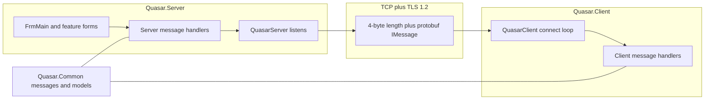

# Overview

Quasar is split into a listening console and a connecting agent. They do not share UI code. They share a protocol library.

## The three assemblies

| Project | Role |
|---|---|
| `Quasar.Common` | The contract. Message types, models, protobuf serialization, shared helpers. Both sides depend on this. Neither side references the other. |
| `Quasar.Server` | The operator console. A WinForms app that listens, lists connected machines, and opens one window per feature. |
| `Quasar.Client` | The agent. A WinForms app that hides its window, connects out, identifies itself, and executes the messages it receives. |

`Quasar.Common.Tests` covers the shared library only.

## Direction of the connection

The client dials the server. The server never opens a connection toward a machine. A machine can sit behind NAT and still appear in the list, as long as the server port is reachable from that machine.

## What a session is

1. The server listens on a TCP port and wraps each accepted socket in TLS.
2. The client connects, then sends one identification message.
3. The server checks that identification. On success it tells the client it is accepted and adds the machine to the list.
4. After that, feature windows send request messages. The client answers with response messages. Both sides use the same dispatcher.

Until identification succeeds, feature messages are not processed. A dropped connection clears the identified flag, so the next connection identifies again.

## What is not a normal window

Most features are request and response: the console asks, the agent answers. Two paths sit beside that pattern.

- The keylogger is a background service on the client. The console reads stored logs later. It is not a live request for every key.
- Reverse proxy keeps its own sockets. The console accepts a local connection. The client opens the matching outbound connection. Control messages for that proxy still ride the main TLS session.

## Supported runtime

The project targets .NET Framework 4.5.2 or higher and Windows, 32-bit and 64-bit. The solution file is `Quasar.sln`. Built executables are written to the `Bin` directory.
