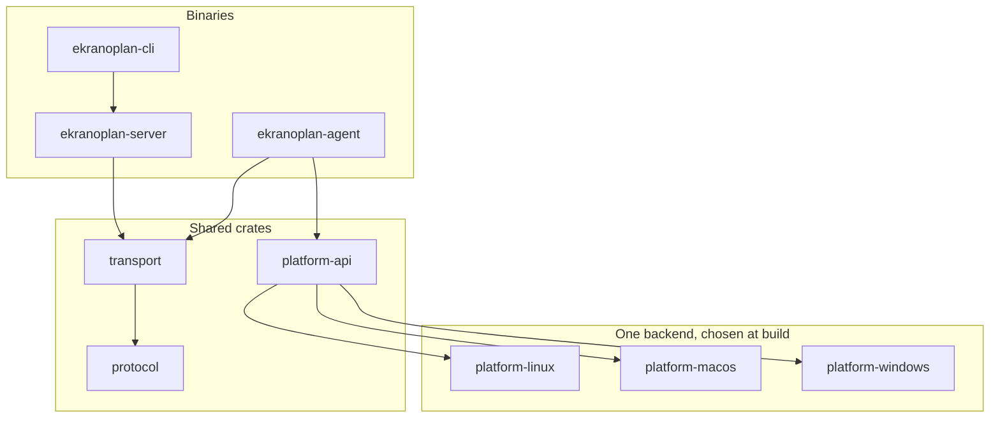
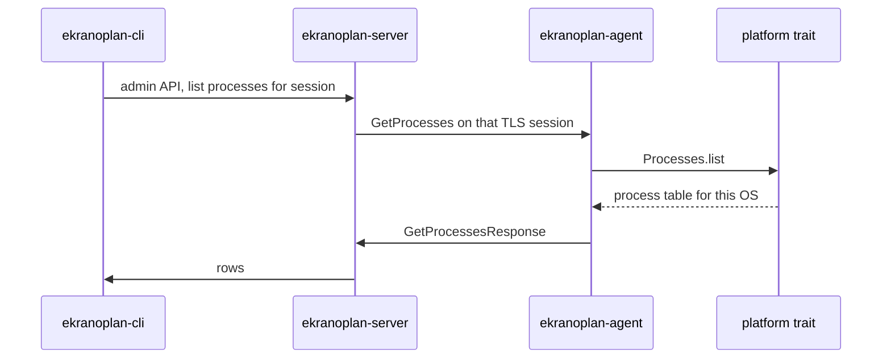

# Windows coupling and a platform-agnostic Rust design

Quasar runs only on Windows. The session model does not require that. The client dials the server, the bytes are length-prefixed protobuf over TLS, and a handler claims each message. None of that is a Win32 API.

What forces Windows is everything around that pipe: the runtime, the UI toolkit, the system calls inside the handlers, and a handful of features that are Windows concepts rather than administration concepts.

This note separates those layers and describes a Rust rewrite, called Ekranoplan here, that keeps the session model and runs the same agent on macOS, desktop Linux, and a headless Linux server. The console listens on any of those, including a Linux server with no display.

## Where Windows is baked in

Both executables target `net452` and `UseWindowsForms`. `Quasar.Client` and `Quasar.Server` are `WinExe` projects. The shared library references `System.Management`, which on this stack is WMI. There is no `net6` or `net8` target, and no runtime identifier for `osx` or `linux`.

The coupling sits in four bands. A port has to peel them in this order. The inner band is already portable. The outer bands are not.

```text
┌─────────────────────────────────────────────┐
│  WinForms console, designer files, icons    │  UI toolkit
├─────────────────────────────────────────────┤
│  Registry, schtasks, GDI, WMI, user32       │  OS features
├─────────────────────────────────────────────┤
│  WinExe, net452, DllImport, unsafe blocks   │  Runtime
├─────────────────────────────────────────────┤
│  IMessage, length prefix, TLS, handler bus  │  Already portable
└─────────────────────────────────────────────┘
```

### Runtime

| Coupling | Where it shows up |
|---|---|
| .NET Framework 4.5.2 | Every `.csproj`. This runtime is Windows-only. |
| WinForms message loop | `Program.cs` on both sides calls `Application.Run`. The agent is a hidden `Form` so it can pump UI messages. |
| P/Invoke | `DllImport` of `kernel32.dll`, `user32.dll`, `gdi32.dll`, `advapi32.dll`, `iphlpapi.dll`, `msvcrt.dll`, `uxtheme.dll`, `shell32.dll`, `shlwapi.dll`. A missing DLL is a load failure, not a skipped feature. |
| Unsafe code | `AllowUnsafeBlocks` is on. `Quasar.Common/Video/Codecs/UnsafeStreamCodec.cs` and `Quasar.Common/NativeMethods.cs` use pointer copies through `msvcrt`. |
| Windows paths and accounts | Install paths use `Environment.SpecialFolder`. Account type and startup use Windows notions of admin and logon. |

`PlatformHelper` checks `PlatformID.Win32NT` and then runs a WMI query, `SELECT Caption FROM Win32_OperatingSystem`. It also notices Mono. That check does not make the process portable. The next line still asks WMI for a Windows caption, and the handlers below it still call Win32.

### UI

The operator console is WinForms. `FrmMain` and every feature form have a `.Designer.cs` and usually a `.resx`. Custom controls (`HexEditor`, `ListViewEx`, `RapidPictureBox`, `DotNetBarTabControl`) call `user32` for carets, themes, and list-view messages. Those controls do not exist on macOS or on a Linux server.

The agent also depends on WinForms, but only for three reasons: the hidden message loop, a tray icon, and balloon tips. None of those exist on a server that has no session and no tray.

### Features that call Windows by name

| Feature | Windows API it actually uses | What another OS would need instead |
|---|---|---|
| System identity | WMI `Win32_OperatingSystem`, a hardware id from Windows device APIs | `sysinfo` / `uname`, and a stable host id from the OS |
| Processes | `System.Diagnostics.Process` plus Win32 details | `/proc` on Linux, `libproc` on macOS, the same trait either way |
| Files | .NET file APIs plus a drive list shaped like `C:` | POSIX paths. Linux servers have no drive letters. |
| Shell | `cmd` via `Quasar.Client/IO/Shell.cs` | `sh` or the user's shell. The message stays `DoShellExecute`. |
| TCP table | `iphlpapi.dll` in `Quasar.Client/Utilities/NativeMethods.cs` | `lsof`/`/proc/net` on Linux, `libproc` on macOS |
| Startup items | `schtasks` and `HKCU\Software\Microsoft\Windows\CurrentVersion\Run` in `ClientStartup.cs` | No shared concept. See the capability section. |
| Registry | `Microsoft.Win32.Registry` and a full editor | Windows-only. Do not invent a fake registry on Linux. |
| Remote desktop | `gdi32` `BitBlt` and `user32` input injection | A desktop session. A headless server has nothing to capture. |
| Power | Shutdown, restart, standby through Windows power APIs | `shutdown` where the OS allows it. Standby is meaningless on a server. |
| Keylogger | The `MouseKeyHook` package, Windows hooks | Not part of this design. |
| Password recovery | Browser and FTP readers, including `advapi32` in the Internet Explorer reader | Not part of this design. |

Registry, the Run key, and Scheduled Tasks are Windows products. A Linux port that creates `HKCU` in a file so the old editor still opens would preserve the Windows UI by lying about the machine. The portable design drops the message when the peer has no such object, and the console hides the menu.

## What stays the same

The session from [networking](networking.md) and the bus from [message-bus](message-bus.md) move over with different libraries and the same behavior.

- The agent dials. The console never connects outbound to a machine.
- TLS 1.2 or newer, with the agent pinning the console certificate.
- A 4-byte length prefix, then one protobuf message. Cap the payload at 5 MB.
- One identification message before any feature message. A failed check closes the socket. A reconnect identifies again.
- Handlers expose `can_execute` and `can_execute_from`. The console handler is bound to one connection. The agent handler accepts the single console it dialed.
- Request names stay `Get*` and `Do*`. Replies stay `*Response`.

`protobuf-net` and `SslStream` are replaced. The framing rules are not.

## Rust workspace

One cargo workspace. The OS-specific code is confined to `platform-*` crates. The protocol crate does not mention Windows, macOS, or Linux.

```text
ekranoplan/
├── Cargo.toml
├── crates/
│   ├── protocol/          messages, prost types, length prefix
│   ├── transport/         tokio, rustls, read state machine, handler bus
│   ├── platform-api/      traits only. no syscalls
│   ├── platform-linux/    /proc, systemd-aware host facts, POSIX files
│   ├── platform-macos/    libproc, POSIX files, launchd is not implied
│   └── platform-windows/  optional later port of the same traits
├── bins/
│   ├── agent/             no UI. connects out. selects a platform crate
│   ├── server/            listens. session table. no UI
│   └── cli/               operator tool. talks to the local server
└── docs/
```



### `protocol`

`prost` generates the messages. A small codec writes `u32` LE length plus the protobuf bytes and refuses a length above 5 MB. This crate is the old `Quasar.Common/Messages` plus `PayloadReader` and `PayloadWriter`. It has no tokio dependency, so tests stay synchronous.

`ClientIdentification` gains two fields the current message does not have:

| Field | Purpose |
|---|---|
| `os` | `windows`, `macos`, `linux` |
| `capabilities` | Bit set of features this agent can actually run |

The console stores both on the session and uses them to enable menus. A Linux server agent reports `linux` and does not set the desktop or registry bits. The console then has nothing to open for those features, instead of sending a message the peer must reject.

### `transport`

Tokio tasks replace the hand-rolled socket loops.

- `rustls` with the `ring` or `aws-lc-rs` provider. The agent uses a pinned server certificate, the same check `ValidateServerCertificate` does today.
- One task reads frames and pushes `Box<dyn Message>` onto a channel. Another task writes frames from a channel. Handlers do not touch the socket.
- The identification gate lives here. Before the session is marked identified, any frame other than `ClientIdentification` or `ClientIdentificationResult` drops the connection.
- Reconnect lives in the agent binary, not in this crate. The delay stays configurable, with a small jitter, matching `QuasarClient.ConnectLoop`.

The handler bus is a `Vec<Arc<dyn Processor>>` behind a mutex. `Processor` has the same three methods as `IMessageProcessor`. Register and unregister take the mutex. `process` clones the matching list, drops the lock, then runs them. That is the snapshot in `MessageHandler.Process`, without a static global.

### `platform-api`

Traits, and the plain structs the protocol already carries (`ProcessInfo`, `DirEntry`, `TcpConnection`). No `libc`, no `winapi`, no `objc`.

```rust
trait HostInfo {
    fn os_name(&self) -> String;
    fn hostname(&self) -> String;
    fn username(&self) -> String;
    fn host_id(&self) -> String;
}

trait Processes {
    fn list(&self) -> Vec<ProcessInfo>;
    fn start(&self, command: &str) -> Result<u32>;
    fn end(&self, pid: u32) -> Result<()>;
}

trait Files {
    fn list_roots(&self) -> Vec<Root>;
    fn list_dir(&self, path: &Path) -> Result<Vec<DirEntry>>;
}

trait Shell {
    fn exec(&self, command: &str) -> Result<ShellOutput>;
}

trait NetTable {
    fn connections(&self) -> Vec<TcpConnection>;
}
```

A method that an OS cannot support returns `Error::Unsupported`. The agent handler turns that into the existing response type with an error flag, the same way registry responses already carry `IsError`. The trait does not grow a Windows method just because the old client had one.

### Platform crates

`platform-linux` and `platform-macos` implement the traits. `platform-windows` can implement them later so a Windows machine speaks the new protocol. It is not required for the Mac and Linux goal.

Linux host facts come from `/proc` and `uname`. macOS host facts come from `sysinfo` and `libproc`. File listings use `std::fs` on both. The shell spawns `sh -c` on both, not `cmd.exe`. Process listing uses `/proc` on Linux and `libproc` on macOS.

Build the agent three times. Each binary links exactly one platform crate. Do not detect the OS at runtime and compile all three into every binary. A Linux server image should not contain the macOS backend.

```text
cargo build -p ekranoplan-agent --no-default-features --features platform-linux
cargo build -p ekranoplan-agent --no-default-features --features platform-macos
```

The server and the CLI have no platform feature. They run wherever tokio and rustls run.

## Two programs, three roles

Today the server is a GUI and the client is a hidden GUI. That split cannot host a Linux server, and it forces a tray icon onto machines that have no user logged in.

| Binary | Runs on | Has a window | Job |
|---|---|---|---|
| `ekranoplan-agent` | macOS, desktop Linux, Linux server, and later Windows | No | Dial, identify, execute portable features |
| `ekranoplan-server` | Any of the above, including a headless server | No | Listen, TLS, session table, fan-out to feature tasks |
| `ekranoplan-cli` | Same host as the server, or a remote admin over SSH | Terminal | List sessions, open a shell, list files, stop the listener |

The server binds the listen port and holds the session map. The CLI connects to the server over a Unix socket on macOS and Linux (`/run/ekranoplan/admin.sock`, mode `0600`) and over a named pipe on Windows. The CLI is not a second TLS peer. It is a local admin API. Feature bytes to a remote agent still travel only on that agent's TLS session.

On a Linux server the operator SSHes in and runs `ekranoplan-cli`. There is no WinForms port and no requirement for a display, X11, or Wayland. A desktop UI can be a later crate that speaks the same admin API. It is not on the path that makes the agent and the listener portable.

The agent is a normal foreground process under a service manager the operator already uses (`systemd` unit, `launchd` plist they write themselves, or a shell in the foreground). The Windows installer, the Run key, and `schtasks` from `ClientStartup.cs` are not reimplemented. Those exist to place the Windows executable on a Windows logon. They are not a portable subsystem.

## Feature map

Portable features keep their message names so a handler still reads like the C# switch in `TaskManagerHandler`.

| Current feature | In the Rust agent | Notes |
|---|---|---|
| Identification, reconnect, disconnect | Yes | `os` and `capabilities` added to identification |
| Task manager | Yes | `Processes` trait |
| File manager | Yes | Roots are `/` on Unix, not drive letters. Transfer messages stay |
| Remote shell | Yes | `sh -c`. The console is a terminal in the CLI, not `FrmRemoteShell` |
| System information | Yes | `HostInfo` |
| TCP connections | Yes | `NetTable`. Closing a remote socket is best-effort and may be unsupported |
| Shutdown | Partial | Linux and macOS can reboot or power off when the process is allowed to. Standby is desktop-only and stays unsupported on a server |
| Startup manager | No | Windows Run key and `schtasks` have no honest equivalent in the trait set |
| Registry editor | No | Windows-only. Capability bit unset. Menu hidden |
| Remote desktop | Desktop only, later | A headless server reports the capability off. Not in the first portable slice |
| Reverse proxy | Later | The message family is portable. The extra sockets are a second slice, same `ReverseProxy*` types |
| Visit website, message box | No | Both assume a logged-on desktop session |
| Keylogger | No | Left on Windows, in the existing C# client |
| Password recovery | No | Left on Windows, in the existing C# client |

The first slice that proves the design is identification, process list, directory list, and a remote shell, on both a Mac and a Linux server, against one `ekranoplan-server` binary.

## How a portable call crosses the bus

Same sequence as Task Manager in the C# code. Only the types under the handler change.



On Linux, `Processes.list` reads `/proc`. On macOS it calls `libproc`. The protobuf type `ProcessInfo` is identical. The CLI prints the same columns.

`can_execute_from` is equality on the session id. Two CLI users requesting shells on two agents cannot receive each other's `DoShellExecuteResponse`, because each server-side task is bound to one session, just as `TaskManagerHandler` stores one `Client`.

## What this does not solve by pretending

Some Windows behavior should stay unimplemented on other systems.

- **Registry and startup.** Hiding those menus is the fix. A synthetic registry file on Linux would train the console to show keys the machine does not have.
- **Desktop capture and input.** A server build has no framebuffer. The capability bit is off. A later desktop backend can set the bit on macOS and on a Linux machine that has a seat. That backend is a separate crate, not a branch inside `platform-linux` that also runs on servers.
- **Keylogger and password recovery.** They stay in the Windows C# client. The Rust agent does not grow those handlers, on any OS.
- **The WinForms console.** It is not wrapped in Wine and it is not rewritten with a Windows-only UI toolkit. Headless operation is a first-class server path, not a degraded GUI.

## Migration order

The review-sized breakdown of this order is one file per phase in [phases](phases/README.md).

1. `protocol` and frame tests. Golden bytes for `ClientIdentification`, `GetProcesses`, and `GetProcessesResponse`.
2. `transport` listen and dial, certificate pin, identification gate, reconnect.
3. `platform-linux` and `platform-macos` for `HostInfo`, `Processes`, `Files`, and `Shell`.
4. Agent and server binaries. CLI lists sessions and opens a shell.
5. File transfer messages, then TCP table, then power where the OS allows it.
6. Capability bits wired through the CLI so unsupported menus are absent.
7. Optional Windows platform crate if a Windows agent must speak the new protocol.
8. Desktop capture only after the headless path is boring.

The C# solution stays as the Windows reference until a feature has a Rust handler and a test against the same protobuf types. Both can speak to a Rust server only after step 1 fixes the subtype numbering. `protobuf-net` assigns subtype indexes in discovery order. `prost` uses explicit field numbers. Those numbers have to be written down once and shared. They cannot be implicit anymore.

## Libraries

| Concern | C# today | Rust |
|---|---|---|
| Messages | protobuf-net 2.4.8 | prost |
| Async sockets | blocking sockets and a thread | tokio |
| TLS | `SslStream`, TLS 1.2 | rustls |
| Host facts | WMI | sysinfo, plus `/proc` or `libproc` |
| Frames | `PayloadReader` / `PayloadWriter` | a `Codec` in `protocol` |
| UI | WinForms | none in the first slice. CLI on a terminal |
| Config | `Settings.cs` constants, or builder ciphertext | a TOML file passed on the command line |

The agent takes a config file with hosts, the pinned certificate path, and the reconnect delay. Release builds do not embed ciphertext in the binary. The server takes a config file with the bind address, the port, and the certificate path. That removes `FrmSettings` and `FrmBuilder` from the portable path.
